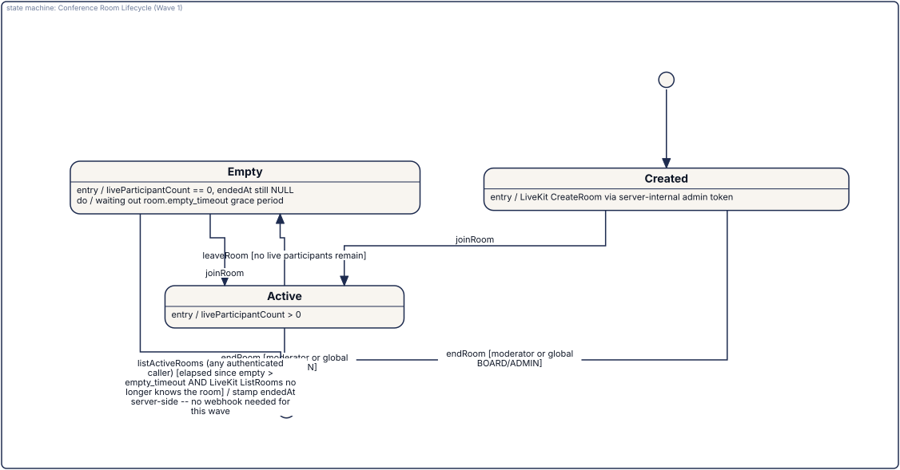

= Videokonferenzen (V1.0 Wave 1)
:toc:

A self-hosted video-conferencing module for small meetings (the concept note's "Kleinsitzung" use
case, first application: Vorstandssitzungen) — own infrastructure on
https://livekit.io[LiveKit] rather than an embedded third-party widget or a BigBlueButton
integration, matching this project's "own stack, own data" posture everywhere else. `IConferenceService`
covers room creation/join/leave/end, a live participant roster, and moderator actions
(remove a participant, end the room for everyone); the KVision client (`ConferenceScreen.kt`) adds a
responsive video-tile grid, a persistent control bar (microphone/camera/screen-share/chat/leave), and
a collapsible ephemeral chat panel riding LiveKit's own data channel. Since V1.4.23 the call also offers background blur and six built-in background images, processed
locally in the browser (no image is sent to the server; the segmentation WASM and model are served from this
server, never from a CDN). On a browser or device without the required support -- and, deliberately, inside the
mobile app's embedded WebView, where the combination has never been measured -- the row stays visible but disabled
with an explanation -- see link:../architecture/video-background-effects.adoc[video-background-effects.adoc]. Two-tier roles only in this
wave: MODERATOR (the room's creator) and PARTICIPANT (everyone else), with a global BOARD/ADMIN
escalation on the two moderator-only actions — see `IConferenceService` KDoc for the full
per-method authorization table.

Local development/testing infrastructure (`deploy/local/` — this repository's first Docker setup) and
a full local-run recipe, including a two-browser manual verification walkthrough and an opt-in live
integration test, are documented in link:../../deploy/local/README.adoc[deploy/local/README.adoc].

== Database session timeouts (V1.9.55)

The application pool applies three PostgreSQL session timeouts to every connection (integer milliseconds, `0` = off, an invalid value stops
the start). `deploy/example/docker-compose.yml` forwards them with the defaults below.

[cols="2,1,3", options="header"]
|===
| Variable | Default | Meaning
| `LAPIS_DB_LOCK_TIMEOUT_MS` | 10000 | Maximum wait for a row or index lock.
| `LAPIS_DB_STATEMENT_TIMEOUT_MS` | 60000 | Maximum run time of one statement (must be greater than the lock timeout unless one of them is 0).
| `LAPIS_DB_IDLE_TX_TIMEOUT_MS` | 120000 | Maximum idle time inside an open transaction.
|===

Exposed re-runs a failed transaction up to three times, so one request can wait up to three lock timeouts. A timeout reaches the user as
"The server is currently busy" and never shows database text. No migration. Details, relaxations (export, full-text index) and the
idempotency table: link:../architecture/database-timeouts-and-retries.adoc[database-timeouts-and-retries.adoc].

== Postgres test lane (V1.9.37)

The normal test suite runs on H2. A second Gradle task, `./gradlew :lapis-server:postgresTest`, runs the engine-dependent specs (Flyway
chain, schema equivalence with H2, row locks, isolation, deadlocks, concurrency) against a real, disposable PostgreSQL; it is part of `check`
and is skipped when `LAPIS_TEST_POSTGRES_URL` is not set. CI runs it in its own job (V1.9.58) against a `postgres:17` service container, and fails that job when the lane was skipped. Start it locally with a
fresh Docker container bound to `127.0.0.1` -- see link:../architecture/postgres-test-lane.adoc[postgres-test-lane.adoc]. Never set
`LAPIS_DB_URL` for it and never point it at a real database (the lane refuses).

NOTE: GitHub's built-in `.adoc` viewer does not load the `kuml-asciidoc` extension, so it cannot
execute the `[kuml]` macro below and shows its raw source instead. The image immediately below is a
pre-rendered copy of that exact model, committed purely so GitHub's preview has something to show
— the `[kuml]` block underneath stays the single source of truth (see "Documentation Convention"
below) and is what actually renders in Antora/local Asciidoctor builds. **If you edit the model,
re-render `docs/images/conference-room-lifecycle.svg` from it** (`kuml render <extracted-source>
--format svg`) — nothing enforces that these two stay in sync automatically.

[kuml, conference-room-lifecycle, svg]
----
import dev.kuml.sysml2.dsl.sysml2Model

sysml2Model(name = "ConferenceRoomLifecycle") {

    val initial = stateDef(name = "Initial", isInitial = true)
    val created = stateDef(
        name = "Created",
        entryAction = "LiveKit CreateRoom via server-internal admin token",
    )
    val active = stateDef(
        name = "Active",
        entryAction = "liveParticipantCount > 0",
    )
    val empty = stateDef(
        name = "Empty",
        entryAction = "liveParticipantCount == 0, endedAt still NULL",
        doAction = "waiting out room.empty_timeout grace period",
    )
    val ended = stateDef(name = "Ended", isFinal = true, entryAction = "endedAt stamped")

    transition(name = "init", source = initial, target = created)
    transition(name = "firstJoin", source = created, target = active, trigger = "joinRoom")
    transition(
        name = "moderatorEndsCreated", source = created, target = ended,
        trigger = "endRoom", guard = "moderator or global BOARD/ADMIN",
    )
    transition(
        name = "moderatorEndsActive", source = active, target = ended,
        trigger = "endRoom", guard = "moderator or global BOARD/ADMIN",
    )
    transition(
        name = "lastLeaves", source = active, target = empty,
        trigger = "leaveRoom", guard = "no live participants remain",
    )
    transition(name = "rejoin", source = empty, target = active, trigger = "joinRoom")
    transition(
        name = "moderatorEndsEmpty", source = empty, target = ended,
        trigger = "endRoom", guard = "moderator or global BOARD/ADMIN",
    )
    transition(
        name = "lazyReconcile", source = empty, target = ended,
        trigger = "listActiveRooms (any authenticated caller)",
        guard = "elapsed since empty > empty_timeout AND LiveKit ListRooms no longer knows the room",
        effect = "stamp endedAt server-side -- no webhook needed for this wave",
    )

    stmDiagram(name = "Conference Room Lifecycle (Wave 1)") {
        include(state = initial)
        include(state = created)
        include(state = active)
        include(state = empty)
        include(state = ended)
    }
}
----

The `Empty -> Ended` "lazy reconcile" transition is deliberate: this wave has no LiveKit webhook
consumer (every client-visible need is already covered by the LiveKit SDK's own `RoomEvent` stream,
and `endRoom` is a synchronous call), so a room whose participants all simply left — rather than
having the moderator explicitly end it — only gets `endedAt` stamped the next time *any* authenticated
member calls `listActiveRooms` and that reconciliation notices LiveKit no longer lists the room past
its empty-timeout grace. Exact, event-accurate presence timestamps (and, downstream of that, a
"Teilnehmerliste = Anwesenheitsliste" attendance integration) are deliberately deferred to a future
wave that does add webhooks.

**Explicitly out of scope for Wave 1** (see the wave's own KDoc/design-review notes for the full
list): recording/streaming (LiveKit Egress, RTMP), whiteboard/document sharing, breakout rooms,
live subtitles/translation, hand-raise/reactions (since V1.9.127: see "Reactions and raised hands" below), a lobby/Warteraum, the full four-tier
Moderator/Präsentator/Teilnehmer/Zuhörer role model, E2EE, "Termin → Konferenzraum" integration with
the Sitzungen/Gremien module, voting-module integration, federated guest join, and chat persistence
(chat is intentionally ephemeral — it travels only over the LiveKit data channel and is never
written to the database, so it carries no GoBD/DSGVO retention obligation). The Wave 1 design
review additionally flagged D1 (single-button room creation instead of today's title-entry form),
D2 (a first-class, non-technical camera/microphone permission preflight screen), D3 (a
speaking-priority reflow above ~12 participants) and D10 (a fully named client-side connection
state machine) as polish items for the next Videokonferenzen step. D3 was built later and then
removed again in v0.32.0 (V1.9.115) in favour of the paged gallery and the switchable views (see
"Views" below); D2 and D10 are still open, see `ConferenceScreen.kt`'s own file KDoc.

== A conference across navigation (V1.9.69-V1.9.71, released in v0.31.1)

Client only, no server change; see `[0.31.1]` in `CHANGELOG.md`. **Navigating no longer ends the call** (V1.9.70): the call
view is kept in a conference dock and only hidden, so microphone, camera, remote audio, chat, roster, running votes and a secret-ballot
receipt keep running. While the call view is not on screen, a mini bar at the bottom of the page stands for it (status, recording /
live-stream badges, "Abstimmung läuft", microphone, camera, stop sharing, "Verlassen", "Zur Konferenz"); from 768 px a small,
non-modal **floating window** (V1.9.71) does so by default, with a big picture, up to three more pictures, the same controls, three sizes,
drag and resize plus a full keyboard alternative; "Einklappen" turns it back into the bar, and its position and size are remembered on
the device. A phone only gets the bar. There is one conference per browser tab. The call still ends with "Verlassen", "Für alle
beenden", a kick, the end of the meeting, sign-out, an account switch, a language switch, and a reload or closing the tab.
**One account, one device** (V1.9.69): a second sign-in with the same account evicts the first connection, which now shows "Auf einem
anderen Gerät verbunden" with "Hier fortsetzen" / "Zur Übersicht" instead of re-joining by itself (automatic re-joins are bounded to
3 per 60 s); multi-device support is planned, not built. The encounter room is not part of the dock (leaving its page still ends it).
**Not verified**: no test with a real call, real participants, two real devices, Safari/iOS or a real phone; no picture-in-picture and no
chat in the floating window; the new texts are agent translations not checked by native speakers. See
link:../architecture/conference-dock.adoc[conference-dock.adoc].

== Moderation: mute, ask, lock the microphones (V1.9.108)

In a running call the room creator and `BOARD`/`ADMIN` can mute one person or everybody ("Alle stummschalten", with a confirmation that names the count), ask a person to switch the microphone on ("Bitten"; a moderator can only ask, never switch a microphone on), and set two room options in the "Moderation" disclosure: **join muted** and **lock the microphones**. A lock is enforced by the server (the join token of a non-moderator carries no microphone publish source, present participants are updated, and a reconciler closes the gap of a reconnect with an old token). Somebody without `BOARD`/`ADMIN` cannot mute or ask a `BOARD`/`ADMIN`. The audit log records the actor, the action, the room and a count, never the people affected. `enable_remote_unmute` must stay off in every LiveKit configuration.
The mechanism was verified against a real LiveKit 1.13.5 with a real microphone publisher; the participant token claim against a real browser join and the client behaviour in a real browser call or a mobile WebView were not. See link:../architecture/conference-moderation-audio.adoc[conference-moderation-audio.adoc].

== Recordings: layout, sync and "Neu berechnen" (V1.9.109)

The composed recording now shows who is actually in the picture: a person who leaves disappears from the grid, a person who joins late does not squeeze everybody from the first second, and the grid is the same best-fit grid the call itself uses
(1 person full picture, 2 side by side, 3-4 as 2 x 2, 5-6 as 3 x 2, and so on); with a shared screen it is large with the cameras in a row below it. A camera that is switched off leaves the picture; there is no grace period, a camera that is
switched off and on within a second changes the layout twice. Picture and sound are kept in step over a long meeting (the recording is built in segments of at most two minutes, so a mistake cannot grow).

A moderator can compose a finished recording anew with **Neu berechnen** (left of "Löschen" in the recordings list). The current video stays available until the new one is finished and then replaces it; the previous version remains in the document
store as an earlier version. This needs the raw tracks: on instances that delete them after a successful composition (the default, `LAPIS_RECORDING_KEEP_RAW=false`) the button is disabled and says "Die Rohspuren sind nicht mehr vorhanden." The same budget as
"Umkodierung neu starten" applies (at least 15 minutes between two attempts, 3 per 24 hours per recording). See link:../architecture/conference-recording.adoc[conference-recording.adoc].

== Views: gallery, speaker large, pinned person, shared screen large (V1.9.115)

Everybody in a call picks how the room looks for them with the button "Ansicht" on the call bar (in a narrow bar it is the first control that moves into the "Mehr" sheet): **Galerie** (all people in pages of 25 / 9 / 4 depending on the width, arrows with "Seite 2 von 3"), **Sprecher groß** (whoever is speaking is large, the others are thumbnails below), **Person anheften** (one chosen person large; a pin appears on every tile when you hover or focus it, always on a touch screen, and tapping a thumbnail pins that person) and **Bildschirmfreigabe groß** (only while somebody shares; it also switches on by itself when a share starts and goes back to your earlier view when it ends).
The large tile does not strobe: it changes to a new speaker only after about 0.8 s of speech and at most every 2 s. If somebody is speaking on a page you are not looking at, the page arrow towards them gets a gold ring; the page never changes by itself. If the pinned person leaves, the view becomes "Sprecher groß" and a spoken notice says so. Only the choice Galerie / Sprecher groß is remembered in the browser (never a person); the floating window follows the large tile. The view replaces the old "priority zone" above 12 people. Not available in the event guest page and the encounter room.

A moderator also decides how **recordings** show the room ("Moderation" in the "Mehr" sheet, "Ansicht bei Aufzeichnung und Stream": *Raster* or *Sprecher groß*); the notice that a recording runs names the view. With *Sprecher groß* the server works out who is speaking from the recorded microphones (loudness, with the same smoothing as the live view) and stores that timeline until the raw files are deleted; it is not exposed anywhere. A shared screen is always shown large. For live streams the start dialog pre-selects the matching layout; the arrangement then comes from LiveKit's own template (its own switching, and whether it shows a shared screen large is not verified). Details and honest limits: link:../architecture/conference-views.adoc[conference-views.adoc] and link:../architecture/conference-recording.adoc[conference-recording.adoc].

== Recordings per person (V1.9.110, default since V1.9.116)

Since V1.9.116 a recording captures every person as ONE file in which picture and sound are kept together by LiveKit (`LAPIS_RECORDING_EGRESS_MODE` empty or `participant`). The older mode, in which every camera and microphone is a separate file that can drift apart (on one real recording the picture was 5.3 seconds behind the sound), is still available with `LAPIS_RECORDING_EGRESS_MODE=track`.
The mode applies to recordings started afterwards; a recording that is already running keeps the mode it started with. Screen shares are still recorded separately and can be slightly offset against the voice.
The default mode needs noticeably more server CPU (every person is re-encoded). On staging (2026-10-12, one person, a real browser) the picture was about 0.1 to 0.2 seconds earlier than the sound; not yet tried: a camera switched on late, several people, CPU under load (see link:../architecture/conference-recording.adoc[conference-recording.adoc]). Recordings that were made earlier cannot be repaired.

== Optional noise suppression (V1.9.114)

A person can switch on a stronger noise filter for their OWN microphone: the row "Rauschunterdrückung" in the device block of the "Mehr" sheet, directly under the microphone selection, and in the device panel of the encounter room for an office holder (pulpit and steward; the congregation has no switch). It is a switch, not a regulator: no slider, no icon, no listening test.

* **Default OFF** (unless an administrator changed the instance default, see "Instance default" below). The filter is made for speech; singing and music sound altered with it. The hint below the switch says so and is always visible: "Wird nur in diesem Browser verarbeitet. Gesang und Musik klingen damit verändert."
* **Remembered in the browser only.** One `localStorage` key (`lapis.audio.noiseSuppression.v1`, value `on` or, since V1.9.124, `off`) shared by the conference and the encounter room; a person's choice is never sent to the server. A blocked storage means "never chosen" and a choice made on the page then lives for the page only. (The organisation's default described below is a separate server-side setting.)
* **Everything stays local.** The filter is RNNoise (Xiph, BSD-3-Clause) compiled to WebAssembly and run in an `AudioWorklet` of the browser. The worklet and the two WebAssembly builds (with and without SIMD) are served by this server from `/assets/rnnoise-v1/` (immutable, versioned path, SHA-256 pinned in the build); nothing is loaded from a third party. Sizes: about 64 KB worklet and 153 KB / 157 KB WebAssembly, loaded only when a person switches the filter on (or has it remembered).
* **How it works.** The raw microphone track is not replaced and not unpublished: a LiveKit track processor puts `MediaStreamAudioSourceNode` -> RNNoise worklet -> `MediaStreamAudioDestinationNode` in front of the SAME published track. The mute state is not touched (a muted microphone stays muted when the filter is switched on or off), a device change rebuilds the chain around the new track, a reconnect applies the remembered choice again. The filter runs in the session's own `AudioContext` at 48 kHz (not the room-wide web-audio mix, which would route every remote voice through WebAudio).
* **Echo cancellation and automatic gain are never touched.** While RNNoise works, the browser's own noise reduction is switched off for the raw track (`applyConstraints({noiseSuppression: false})`, best effort) so the signal is not filtered twice; whenever the filter is off or not available the browser's own reduction is switched back on.
* **Recording and stream.** They receive the already cleaned track; there is no unfiltered copy and no way for a viewer to ask for one.
* **Fallback, never a dialog.** If the filter cannot be used, the processor is removed again, the switch shows "Nicht verfügbar" with the reason in plain words and a polite status line, the browser's own noise reduction is used, and the remembered choice stays. Since V1.9.119 the reason is one of 12 stage codes, shown in brackets at the end of the sentence (see the table below).
* **A failure is not final (V1.9.119).** Only the failures that cannot change lock the switch. For every other one a click on the switch tries again (the switch stays at "off" until it works), and so does every new microphone track. An automatic start with a remembered "on" that finds the audio context suspended (the browser starts it only after a gesture) waits for the person's next click or key press anywhere on the page, starts the context inside that gesture and tries once more, quietly; if that fails there is no second wait.
* **Console line.** Each failure writes ONE `console.warn` line per stage and trigger: `[noise-suppression] stage=WASM_FETCH trigger=auto error=TypeError message=Failed to fetch ctxState=running ctxRate=48000 trackRate=48000 trackChannels=1` (`-` = unknown; triggers: `auto`, `click`, `gesture`, `restart`, `init`). No personal data: only the numbers above are read from the audio path, never the label, `deviceId` or `groupId` of the microphone, and query strings are cut from browser messages. Raw browser messages are never shown in the panel.
* **Accessibility.** The switch is a real `button` with `role="switch"` and `aria-checked`; Space and Enter work, the focus ring is the global one. While a change runs and while the filter is unavailable for good (a failure that cannot change) it carries `aria-disabled="true"`; `aria-checked` is `true` only while the filter is on. The status element is `aria-live="polite"` (never assertive) and is empty while the page builds: a sentence appears only after a person's own switch-on or on a failure.

=== Instance default (V1.9.124)

An administrator can make the filter the DEFAULT of the instance: `ADMIN` > Mitgliederverwaltung > card "Videokonferenz" > switch "Rauschunterdrückung vorgeben" (`IOrganizationSettingsService.updateNoiseSuppressionDefault`, ADMIN only; column `organization_settings.noise_suppression_default`, migration `V99`, default `FALSE`, so nothing changes until the switch is used). A change writes one audit entry (`ORGANIZATION_SETTINGS`, `UPDATE`, one-field before/after snapshot, no personal data); setting the value it already has writes nothing. The generic `updateOrganizationSettings` never touches the column.

* **Order of precedence.** The person's remembered choice (`on` or `off`) beats the instance default, the default beats "off". So the default only decides for a person who never chose in this browser, and it never overrules a choice.
* **The default is not a choice.** The automatic paths (start of the page, a published microphone track, the retry on the next gesture) never write the key; only a person's own click on the switch does. A person who switches the default off once has an explicit `off` stored and is never overruled again; a person who just leaves the default alone keeps following later changes of the default.
* **Video conferences only.** The encounter room (pulpit, steward, congregation) is excluded on purpose: singing and music are its normal use. The default reaches the browser in `ConferenceJoinTokenDto.noiseSuppressionDefault` (member, guest, friend, breakout room and online-event joins) and, so the lobby can prepare before the join click, in `ConferenceAvailabilityDto.noiseSuppressionDefault`; the encounter room's join answers always carry `false`, and its pulpit controller is built without any default. Both fields are additive with default `false`, so older answers stay readable.
* **What the person sees.** While the default is what decides, the row shows the plain line "Voreinstellung der Instanz" (no icon, no colour, never announced). It disappears with the person's first click. If the filter cannot start, the switch shows "Nicht verfügbar" with the reason as always, but the automatic attempt is not announced in the live region (a failure after the person's own click still is).
* **First start without a gesture.** A browser starts an audio context only inside a gesture. When the default (or a remembered `on`) applies, the audio context of the filter is created and resumed inside the join click (and the click on the microphone button) and handed over to the session (`NoiseSuppressionWarmup`). Chromium counts the join click as an activation anyway; the warm-up mainly helps Safari and Firefox and is not tested there. If the context still does not run (an automatic rejoin without a click, the mobile web view), the existing "next gesture" hook of V1.9.119 starts the filter on the person's next click.
* **The microphone never goes silent.** Any failure first takes the processor out of the track and switches the browser's own noise reduction back on. A `setProcessor` call that ends after the loading time ran out is undone again.
* **Shared key.** The conference and the encounter room share one key. A person who switches the filter off in the pulpit (for singing) therefore also stores `off` for conferences and is not overruled by the default there afterwards; the same holds the other way round.
* **Honest limits.** CPU and battery cost on weak devices has not been measured; the sound was judged by listening only; only Chromium was tested. A person who deliberately switched the filter off before V1.9.124 has nothing stored (the old code removed the key) and is treated as "never chosen": with the default on the filter starts for them once, until they switch it off again.

[cols="2,1,4",options="header"]
|===
|Code |Retry? |Meaning
|`NO_AUDIO_WORKLET` |no |The browser has no AudioWorklet.
|`NO_WEB_ASSEMBLY` |no |The browser has no WebAssembly.
|`SAMPLE_RATE` |no |The audio context does not run at 48 kHz (RNNoise needs it).
|`NO_AUDIO_CONTEXT` |yes |The browser gave no audio context.
|`CONTEXT_NOT_RUNNING` |yes |The context stays suspended (no gesture yet) or `resume()` was refused or did not answer within 2 seconds.
|`WASM_FETCH` |yes |The WebAssembly file could not be loaded (HTTP status, wrong type, wrong size, abort after 8 seconds, network error).
|`WORKLET_MODULE` |yes |The worklet module could not be registered.
|`NODE_CREATE` |yes |The audio nodes could not be created.
|`SET_PROCESSOR` |yes |LiveKit refused the processor (any other error of `setProcessor`).
|`RESTART` |yes |A device change could not be followed; the raw microphone track keeps being sent.
|`TIMEOUT` |yes |The whole load took longer than 8 seconds.
|`LOAD_FAILED` |yes |Any other error without a known stage.
|===

A second stage (a neural filter such as DeepFilterNet3) is conceivable later; Krisp-style enhanced noise cancellation is not possible with a self-hosted LiveKit. The asset provenance, the licences and the content-security-policy needs are in link:../architecture/video-background-effects.adoc[video-background-effects.adoc] (section "Noise suppression assets").

*Not verified (honest):* the quality of the filter can only be judged by listening and no listening test was made; CPU and battery use were not measured on real devices; the whole flow (a real microphone, a real LiveKit room, a second participant) was not run in a real browser; only the Chromium family is expected to work as designed (Firefox needs the audio context and the microphone at the same sample rate and may fall back; Safari was not tried); the SIMD build was not checked on every device; the filter does not help the table microphones of the congregation, which have no switch.

== Join and leave sounds (V1.9.120)

When somebody joins or leaves a call, every other participant hears one short, quiet two-tone sound: a rising pair of tones for a join, the same two tones mirrored (falling) for a leave. The sound is synthesised in the browser with WebAudio (two sine oscillators per tone, no file, nothing is loaded from the server); the join tone peaks at a gain of 0.10, the leave tone at 0.05.

* **Only in small rooms.** The sound is played only when the room has at most 10 people on BOTH sides of the event: it is silent when the count before OR after the join/leave is above 10 (so the join into a room of ten and the leave out of eleven behave the same). The count is the visible participants including yourself and excluding recorders and other filtered identities; the same filter (`isPresenceCountable`: participant kind `EGRESS`, identity prefix `EG_`) is used for the sound and for the count. The limit lives in one constant (`JOIN_LEAVE_SOUND_MAX_PARTICIPANTS`) and is formatted into the hint text, not typed into the translations.
* **One sound per person per 5 seconds, at most one sound per second.** A person who triggered a sound is silent for 5 seconds; join and leave share that window, so a reconnect (leave, then join) sounds once, as the leave. Any two sounds are at least 1 second apart; a sound that would fall into that gap is dropped, never queued and played late.
* **Never for yourself, never for the first roster.** Your own join and leave are silent. The people already in the room when you join, and a roster resynchronisation after a reconnect, make no sound: the session is "armed" only after the first roster is in, and it is disarmed again by a new connect attempt and by a disconnect.
* **Silent while you reconnect.** Between `Reconnecting` and `Reconnected` nothing sounds, and for a grace window of 2 seconds after `Reconnected` (the SDK can replay participant events shortly after it).
* **Also in a hidden tab.** Unlike the bell of the encounter room, there is no visibility check: the sound is the only sign that somebody arrived while the window is in the background. It leaves through the speaker chosen in the "Mehr" sheet (best effort: `AudioContext.setSinkId` where the browser has it).
* **Two switches.** Personal: "Töne bei Beitritt und Verlassen" in the device block of the "Mehr" sheet, directly below the noise suppression. A `role="switch"` button, on by default, remembered in the browser only (`localStorage` key `lapis.conference.joinLeaveSounds`, only the value `off` is written; a blocked storage means "on" for this page). Switching on plays the join sound once as a confirmation. Nothing is announced to a screen reader. Room: a moderator (the creator, `BOARD`, `ADMIN`; the same authority and the same single refusal as the audio policy) can switch the sounds off for the whole room in the "Moderation" disclosure ("Töne bei Beitritt und Verlassen in diesem Raum", `IConferenceModerationService.setRoomJoinLeaveSounds`). The room option defaults to on (`conference_room.join_leave_sounds`, migration `V95`, every existing room keeps the sounds). When it is off, the personal switch stays visible but disabled and says "Die Moderation hat die Töne für diesen Raum ausgeschaltet." Breakout rooms follow the option of the main room they were made from.
* **Audit and privacy.** The room option writes one audit entry (`{"moderation":"JOIN_LEAVE_SOUNDS","enabled":false}`), no names. There is no LiveKit call and no server-side enforcement: the sounds are a client behaviour.
* **The encounter room is not affected** (it has its own bell).
* **Autoplay.** A browser lets a sound start only after a user gesture. The audio context is created inside the click that joins (the join button, "Besprechung jetzt starten", the guest entry); a call entered without a click of its own (automatic re-entry) is unlocked by the first gesture on the page. A sound that arrives before that is dropped.

*Limits (honest):*

* The room option reaches a running client only at its next join or reload: nothing pushes it. The moderator who changes it sees it at once; everybody else keeps the old value until then. Making it immediate needs a data-channel signal and a server-side LiveKit call and is a separate wave.
* Autoplay unlocking, `AudioContext.setSinkId` and the actual sound were NOT verified in a real browser, only against a fake audio context (the tests check frequencies, levels, scheduling and that nothing throws). Whether the tones are pleasant and quiet enough has not been listened to.
* A reconnect sounds once (the leave), by design of the shared 5-second window.
* The recorder filter is defensive (kind `EGRESS` or the `EG_` prefix); how the egress participant of the current LiveKit setup actually appears to a client was not observed.

== Friends and guests in a conference (V1.9.126)

A person without a membership can take part in a conference: either a *friend* (a self-registered account on this server, no home server) or a *guest* (a federated account that signs in through its own home server). Both have the status class `NON_MEMBER`, get the same lobby ("Als Gast beitreten") and the same rights in a call. Before V1.9.126 the lobby was chosen by the session flag `isGuest`, which is `false` for a friend, so a friend landed in the member lobby, whose room list is members-only, and saw "Keine Berechtigung". The lobby is now chosen by the member status (`conferenceLobbyKindOf`).

To invite a friend:

. The friend has a friend account on this server (see the friends documentation); a guest signs in through the home server.
. The moderator opens the room, then "Mehr", and clicks "Gäste anderer Server zulassen". The label also means friend accounts; a help text under the row says so. (Renaming the button is deferred.)
. The moderator clicks "Einladung kopieren" and sends the text. It contains the room identifier.
. The friend opens "Videokonferenz" and enters the identifier under "Als Gast beitreten".
. The friend confirms the data protection notice (version `2026-10-13.v1`) and joins.

Things to know:

* Closing the guest access ("Gastzugang beenden") removes every connected guest *including friends* at once.
* `getRoom` and `listActiveRooms` stay members-only: a friend never sees a room list and cannot open a room by its link; the identifier is the only way in. There is no deep link for friends.
* After a short network drop a friend or guest is re-joined automatically like a member; the room is not looked up again (that call is members-only), the join token request decides.
* The consent text names no home server any more in its first layer (a friend has none); the version changed from `2026-08-16.v1` to `2026-10-13.v1`.
* `FriendGuestConferenceParityTest` pins that a friend and a guest get the same result from every conference RPC; the only documented differences are `callerIsGuest` of `getGuestJoinInfo` and the home server shown in `listParticipants`.

== Reactions and raised hands (V1.9.127)

Two small things that make a large call feel like a room: a *reaction* (applause, heart, amen, thumbs up, flower) is a mood that appears on a person's tile for three seconds, and the *raised hand* ("Wortmeldung") puts a person into a list that everybody can see and the moderation can work through.

=== Reactions

* **Five reactions, a menu, no shortcut.** The bar has a "Reaktion" button (`aria-haspopup="menu"`, `aria-expanded`) that opens a menu with five items (`role="menuitem"`, the emoji in an `aria-hidden` span plus the word: Applaus, Herz, Amen, Daumen hoch, Blume). Arrow keys, Home and End move, Enter and Space choose, Escape closes and gives the focus back to the button. There is deliberately no global keyboard shortcut. The button moves into the "Mehr" sheet early on a narrow bar (right after "Ansicht"); the raised hand never moves.
* **Peer to peer, nothing stored.** A reaction is a LiveKit data packet on the topic `lapis-conference-reaction`, reliable, exactly `{"r":"APPLAUSE"}` (at most 32 bytes). The server never sees, counts, stores or audits it. The receiver reads only the key `r` (any other key makes the packet invalid, so a forged sender is never looked at), attributes the packet to the SDK-verified identity of the sender and never throws. `HAND` is *not* a reaction.
* **Flood guards.** Sending: one reaction per second per client. Receiving: at most five per sender per five seconds, at most 64 senders tracked; more are dropped without a trace.
* **On the tile.** The overlay is a child of the tile element's reaction layer, which is built once with the tile (the tile itself is never recreated, `ConferenceViewStage` only re-parents it). At most three reactions are shown at the same time, each for three seconds. The word sits in a visually hidden span, there is *no* live region: a reaction is never announced. The rise animation exists only under `prefers-reduced-motion: no-preference`; otherwise a reaction simply stands there and is removed.
* **Room option.** A moderator can switch the reactions off for the whole room in the "Moderation" disclosure ("Reaktionen in diesem Raum", `IConferenceModerationService.setRoomReactions`, column `conference_room.reactions_enabled`, migration `V101`, default on). The call is rate-limited, writes one audit entry without names (`{"moderation":"REACTIONS","enabled":false}`) and sends a `reactions_on` / `reactions_off` moderation packet so running clients follow at once. A client that missed the packet learns the stored flag at its next join or reload. While the reactions are off the bar button is `aria-disabled` and says "Reaktionen sind in diesem Raum ausgeschaltet."; incoming reactions are dropped.
* **The option works through the clients only.** It does *not* touch the LiveKit permission `can_publish_data`, because the chat travels through the same permission; a modified client can still send a packet, and other modified clients can still show it. Honest limit, not a security boundary.
* **The raised hand is not affected by the room option.**

=== The raised hand ("Wortmeldeliste")

* **The server keeps the order.** Option "c with epoch" of the design: the order lives in server memory (`ConferenceHandQueueState`), per room a monotonic `seq` is raised on every real change, and a random 16-hex *epoch* is drawn once per process. Nothing is written to the database, no time is stored, no history is kept, *no audit entry is written* (not even when a moderator lowers a hand: the list is volatile and an audit would tie people to speaking requests). Logs carry counts and exception classes only (`ConferenceHandsLogPrivacyTripwireTest`). Raising twice keeps the place; lowering and raising again puts the person at the end; at most 100 hands per room.
* **Who may do what.** `IConferenceHandService` (a service of its own, like breakout, whiteboard and recording):
** `raiseHand`, `lowerHand`: any person who may be in the conference (member, guest or friend; the same membership rule as the join) *and is currently present in the LiveKit room* -- the same truth the moderation uses. Raising needs the presence; lowering one's own hand does not. There is no way to lower somebody else's hand through these methods.
** `handQueue`: a present person or a moderator.
** `lowerHandOf`, `lowerAllHands`: the room creator and BOARD/ADMIN (`ConferenceModeratorAuthority`).
** Every refusal of the own-hand and moderation methods (unknown, ended, encounter room, not present, no authority, malformed identity) is the *same* `ForbiddenException`: Kilua transmits only the exception type, so there is no existence oracle. A rate limit and a server without conference configuration are a `ConflictException`. Limits: raise/lower 10 per minute per person and room, reading the queue 30 per minute per person, lowering one hand 30 per minute per room, lowering all 6 per minute per room.
** Event rooms: the same rule as the other read methods (`EventConferenceGuard.requireParticipantOrModerator`, tripwire `ConferenceHandServiceEventGuardTripwireTest`). Encounter rooms are refused.
* **Broadcast.** After every change the server sends the snapshot to the room on the topic `lapis-conference-hands` (server only: a client accepts a packet on this topic *only* if it has no sending participant): `{"v":1,"e":"<epoch>","seq":N,"ids":[...]}`, at most 6144 bytes (100 identities of the form `evg-<uuid>` are 4300 bytes plus the header; 4096 would not be enough). The broadcast is best effort and goes out *after* the per-room lock is released; the RPC answer carries the same snapshot, and a client drops every snapshot that is not newer (same epoch: larger `seq`; other epoch: always newer). *Until V1.9.133 this broadcast could never leave the server* (the `SendData` size limit of every non-moderation topic was 16 bytes, see "Fixed on the way" in the section "Timer"); clients then healed the list only through their own reads.
* **Late joiners and guests without an account.** A member reads the queue with `handQueue` at the join, after a reconnect, once a minute while the own hand is up or the roster is open, and whenever the broadcast might have been lost. An event guest without an account (`evg-` identity) has no session and no RPC access: the reconciler (`ConferenceHandQueueReconciler`, every 5 seconds, only for rooms that hold at least one hand) sends the current snapshot point to point to every identity it sees in the room for the first time. So a guest *sees* the list.
* **The epoch rule.** After a server restart the queue is empty and `seq` starts over. A client that believes its hand is up and does not find it in a snapshot decides by the epoch: *same epoch* means a moderator lowered it -- the client accepts that and tells only the person ("Ihre Hand wurde gesenkt."), it never raises again (that would overrule the moderation); *new epoch* means the server restarted -- the client raises the hand again automatically and lands at the end of the list. The old order is not restored.
* **Presence grace.** The reconciler removes a hand whose owner has been missing from LiveKit for 20 seconds; a reconnect with the same identity inside the grace keeps the place. Somebody who moves into a breakout room leaves the main room, so the hand falls after the grace (by design). An event guest who rejoins gets a new `evg-` identity and loses the hand.
* **In the interface.**
** Bar: a toggle "Hand heben" / "Hand senken" (`aria-pressed`); while the hand is up the accessible name says "Hand senken, Position N" and a badge shows N.
** Tile: a badge "Hand gehoben" with the hand symbol *and* the words, built once with the tile and only shown or hidden afterwards (the speaker mark is independent of it).
** Roster: the symbol and "Hand gehoben" in the row of the person.
** Above the roster: the section "Wortmeldungen", a numbered list in the order of the server (names as text, never markup; an identity without a tile is "Unbekannt"). Only for the moderation: a "Hand senken" button per row (accessible name "Hand von {name} senken"), "Alle Hände senken" with a confirmation dialog, and the switch "Wortmeldungen ansagen".
** Moderators only: a polite live announcement for new hands ("Hand gehoben: Anna", or "3 neue Wortmeldungen" when several arrive within ten seconds; never for the first snapshot of an epoch or for the own hand). The personal switch is remembered in the browser only (`localStorage` key `lapis.conference.announceHands`, only the value `off` is written, every access in `try/catch`; a blocked storage means "on" for this page). Reactions are never announced.
** Mini bar and floating window: "Ihre Hand ist gehoben" and "Gehobene Hände: N" (words, no names).
* **Breakout rooms** have no raised-hand button: the queue belongs to the main room's LiveKit room and the presence rule would refuse a person who sits in a breakout room.
* **An event guest without an account** sees the list, but the button is switched off ("Für Gäste ohne Konto nicht verfügbar"). A route that would let such a guest raise a hand with the LiveKit token they hold (`POST /api/conference/hand`, the token verified server side) was planned as an *optional step* and is *not built*: it needs a decision by the owner first (see the CHANGELOG, V1.9.127).

=== Not in the recording and not in the stream

Reactions and hand badges are DOM overlays of the Lapis client. Recordings and streams do not contain them, and this holds only as long as nothing renders the client page into the broadcast:

* `LiveKitEgressClient` offers exactly four egress kinds (`startTrackEgress`, `startParticipantEgress`, `startParticipantFileEgress`, `startRoomCompositeEgress`). The room-composite egress uses LiveKit's *built-in* layout (`ConferenceStreamLayout`); there is no `custom_base_url`, no template path and no headless browser that renders the Lapis client.
* The recording is composed from the raw per-person tracks by `RecordingComposer` / `FfmpegSegmentedComposer`, never from a rendered page.

`ConferenceReactionsRecordingTripwireTest` fails the build if a custom-template egress, a fifth egress kind or a browser in the composer appears.

=== Not verified (honest)

* Nothing here was seen in a real call with several real people. Everything was exercised by unit, service and DOM tests (a headless Chromium), not by a screen reader or a human; the translations were written by the model.
* Only Chromium was used for the DOM tests; Safari and Firefox were not tried.
* A lost broadcast is healed by the next read (at the latest after a minute while the hand is up or the roster is open, and at every reconnect). A person who has neither raised a hand nor opened the roster can see an outdated list for that time.
* The list is lost on a server restart; clients re-raise automatically, but the old order is gone.

== Timer (V1.9.133)

A countdown that everybody in the room can see -- and nothing else. The timer *shows* the time and *enforces* nothing: nobody is muted, no microphone is closed, no room is ended when it reaches zero. It is for a normal meeting of the main room: encounter rooms and breakout rooms have no timer.

=== Who may do what

* `IConferenceTimerService` (a service of its own, like the raised hand): `startTimer`, `pauseTimer`, `resumeTimer`, `stopTimer`, `extendTimer` for the *moderation* (room creator and BOARD/ADMIN, the shared `ConferenceModeratorAuthority`), and `timerState` for a present person or a moderator.
* The moderator check comes *before* the rate limit and before anything is changed, and every refusal (unknown, ended, encounter or breakout room, malformed id, not a moderator, not present) is the *same* `ForbiddenException`: Kilua transmits only the exception type, so there is no existence oracle. A rate limit (20 control actions per minute per room, 30 reads per minute per person), an impossible transition and a server without conference configuration are a `ConflictException`; a duration outside 10 s to 60 min and an extension that is not 30, 60 or 300 seconds are a `BadRequestException`. Messages never echo the input.
* Event rooms use the same guard as the other read methods (`EventConferenceGuard.requireParticipantOrModerator`, tripwire `ConferenceTimerServiceEventGuardTripwireTest`).

=== The state machine

[cols="1,3"]
|===
|State |Actions

|off |`start` (10 s to 60 min) -> running. Everything else is refused (`stop` is a no-op).
|running |`pause` -> paused, `extend` (+30 s, +1 min, +5 min; the remaining time may not pass 60 min), `stop` -> off. `resume` is a no-op, `start` is refused.
|paused |`resume` -> running, `extend` (the paused time grows), `stop` -> off. `pause` is a no-op, `start` is refused.
|expired |*Derived*, never stored: a running timer whose remaining time is 0. `start` -> running, `extend` -> running with exactly the extension, `stop` -> off. `pause` and `resume` are refused.
|===

The remaining time of a running timer is `endMark - now` on a *monotonic* clock (`TimeSource.Monotonic`); no wall clock takes part in the logic. The wall clock fills only the field `t` of the packet. "Expired" raises no `seq`, writes nothing and needs no scheduler.

=== Memory only, no audit

Like the raised-hand queue, the timer lives in server memory (`ConferenceTimerState`): per room a phase, the remaining time, a monotonic `seq` raised on every real change and a random 16-hex *epoch* drawn once per process. There is no table, no migration, no audit entry and no stored time; logs carry counts and exception classes only. Tripwires: `ConferenceTimerNoPersistenceTripwireTest` (no insert/update/audit, only read transactions, no migration), `ConferenceTimerLogPrivacyTripwireTest`, `ConferenceTimerServiceEventGuardTripwireTest` (the state and the topic are touched only by the service, the reconciler, `Application.kt` and the size limit; the service is registered *last* in `Application.kt`, because Kilua numbers routes in declaration order).

=== Data flow

* **Broadcast.** After every change the server sends the snapshot on the topic `lapis-conference-timer` (server -> client only: a client accepts a packet *only* if it has no sending participant): `{"v":1,"e":"<epoch>","seq":N,"s":"R|P|X|O","d":<ms>,"rem":<ms>,"t":<epochMs>}`, at most 256 bytes (about 100 in practice). It is sent best effort after the per-room lock is released; the RPC answer carries the same snapshot, and a client drops everything that is not newer (same epoch: larger `seq`; other epoch: always newer).
* **Late joiners and guests without an account.** A member reads `timerState` at the join, after a reconnect, whenever the tab becomes visible again and once a minute while the timer runs. An event guest without an account has no RPC: `ConferenceTimerReconciler` (every 5 seconds, only for rooms whose timer is not off) sends the current snapshot point to point to every identity it sees in the room for the first time.
* **Clock offset.** The countdown runs on the *client's monotonic clock* (`performance.now()`), so a changed system clock changes nothing. The offset to the server clock is estimated the way NTP does it: from `timerState` as `t - (send + receive) / 2`, the sample with the smallest round trip of the last five minutes wins. A guest without RPC has only the packet itself (error about one network latency, under 300 ms).
* **Server restart.** The timer is lost. The client sees a new epoch with an off timer while it believed one was set and shows "Timer wurde zurückgesetzt" for eight seconds.

=== In the interface

* **Pill above the tiles** (never over a video): the digits (24 px, bold, tabular figures), a progress ring and the *words* for every phase -- "Gleich vorbei" in the last ten seconds (3 px outline, warning colour, a 1 Hz pulse only without a reduced-motion request), "Zeit abgelaufen" when it ran out (stands still, never a negative time), "Pausiert". The digits are rounded *up*, so 00:00 only appears when the time is really up. For the moderation the pill is a button ("Timer steuern, noch 2 Minuten 15 Sekunden") that opens the dialog; for everybody else it is a `
`. The countdown itself is *not* a live region.
* **Dialog** (moderation; also the "Timer" button of the "Mehr" sheet): presets 1, 2, 3, 5, 10 minutes (default 5) and "Eigene Zeit" (minutes 0-60, seconds 0-59, inline message "Zwischen 10 Sekunden und 60 Minuten", "Starten" stays off while the input is invalid); for a running or paused timer "Pausieren"/"Fortsetzen", "+30 s", "+1 min", "+5 min" (off when the remaining time would pass 60 minutes) and "Stoppen".
* **Mini bar and floating window:** "Timer 02:15" with a 2 px bar; in the last ten seconds "⚠" (decorative) and "Gleich vorbei".
* **Screen reader:** a polite live region of its own says "Timer gestartet: ...", "Timer pausiert", "Timer fortgesetzt", "Timer gestoppt", "Noch eine Minute" (only for timers of at least two minutes), "Noch 10 Sekunden" and "Zeit abgelaufen"; at most one note per five seconds, the end always; somebody who joins a running timer hears nothing about the state they found.
* **Gong:** an optional soft gong at the end (switch "Gong am Ende" in the "Mehr" sheet, on by default, remembered per browser under `lapis.conference.timerGong`, only the value `off` is written). It is synthesised with WebAudio (392 Hz plus two inharmonic partials, peak 0.12, 5 ms attack, about 2.2 s decay), played by the tab's single audio player (the same context, unlock and speaker as the join and leave tones) and *only* for an end that was experienced live: not for the first snapshot, not when the end is more than two seconds old, and never queued when the browser does not let the audio context run.
* **Contrast** (WCAG, calculated): digits on the pill 17.8:1 (light) and 13.0:1 (dark), ring 6.5:1 and 5.1:1; the last ten seconds white on `--lapis-role-guest` 5.0:1 and dark on its dark-mode value 9.1:1; expired 7.1:1 and 7.6:1.

=== Not in the recording and not in the stream

The timer is a page element of the Lapis client. It is not part of the video overlays (V1.9.129 computes those *into* the camera track; the timer must never go there) and not part of any recording or stream. `ConferenceTimerRecordingTripwireTest` fails the build if a custom-template egress, a fifth egress kind, a browser in the composer, a mention of the timer in the video-overlay files or a media-track call in the timer's client files appears; `ConferenceTimerClientTripwireTest` guards that the topic is read in one place, before the participant check.

=== Fixed on the way: the size limit of `SendData` (V1.9.127)

`HttpLiveKitAdminClient.sendData`/`sendDataTo` knew only two limits -- the moderation topic (128 bytes) and *everything else* (16 bytes, the encounter blessing). A raised-hand packet is about 47 bytes even for an empty queue, so every `sendData` on the hands topic failed with an `IllegalArgumentException` (not a `LiveKitAdminException`): the state changed, the call answered with a server error and the broadcast never went out. The tests did not see it because they use a fake client. Since V1.9.133 there is one limit per topic (`sendDataPayloadLimit`: moderation 128, hands 6144, timer 256, anything else 16) and `LiveKitAdminClientPayloadLimitTest` sends real packets through the real client.

=== Not verified (honest)

* Nothing here was seen in a real call with several real people; it was exercised by unit, service and DOM tests (a headless Chromium), not by a screen reader or a human. The seven translations were written by the model.
* Only Chromium was used; Safari and Firefox were not tried. The gong depends on the browser's autoplay rules: a tab that never had a user gesture may stay silent.
* The timer is lost on a server restart; clients show the reset note.
* An event guest without an account estimates the clock offset from the packet alone (about one network latency, under 300 ms); a periodic refresh broadcast was considered and not built.
* Breakout rooms are other LiveKit rooms: nobody sees the main room's timer from inside a breakout room.

== Video overlays (V1.9.129)

Members may place logos, their name and a frame in their own camera image when an ADMIN offers it. The overlay is part of the sent picture and
therefore of recordings and livestreams. See link:video-overlays.adoc[video-overlays.adoc].

== Streaming to X (V1.9.131)

X (formerly Twitter) is a platform of its own in the admin list "Stream-Ziele". It behaves like a generic RTMP destination, with its own label and a hint in the create dialog.

* Server URL and stream key are in X's Media Studio, under "Producer". Nothing is prefilled: the ingest address of X is not reliably known, so the field stays empty (placeholder `rtmps://...`).
* The key may change with every broadcast. When it does, open "Bearbeiten" on the destination and enter the new key (it is write-only and never displayed).
* Tested with X on 2026-10-14 using the *Single person* layout only; other layouts, long-running streams and picture quality are untested. The grid and speaker layouts use the LiveKit web template and are not tested with X.

Details: link:../architecture/conference-recording.adoc[conference-recording.adoc], section "Streams (RTMP)".
